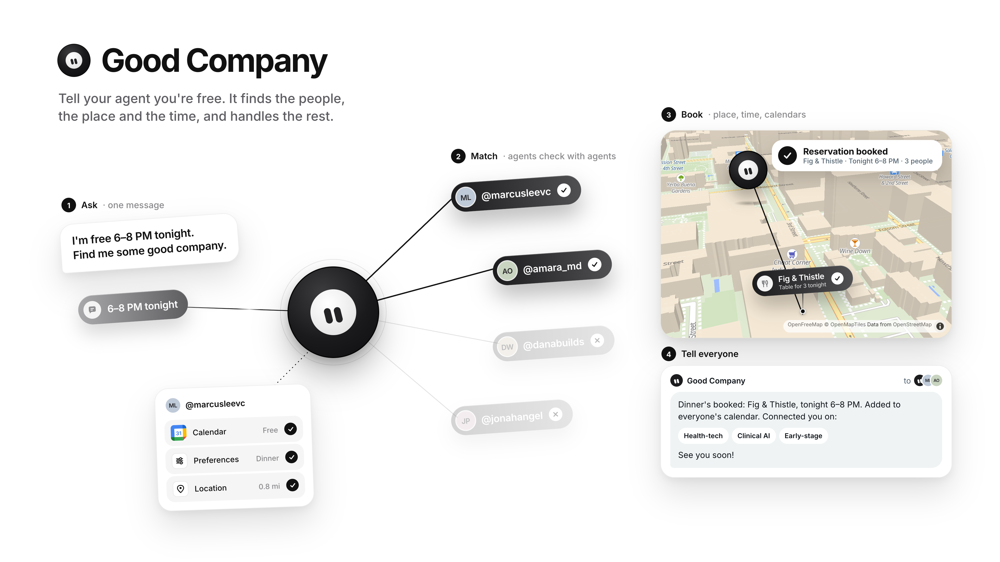

# Good Company visualizer

An animated walkthrough of what Good Company does, from one message to a booked dinner. Built for the demo so people can see the whole agent flow in about 70 seconds without needing a live run.

## What's in here

| File | What it is |
| --- | --- |
| `index.html` | The animation. A single file with no build step. Open it in a browser. |
| `good-company-visualizer.mp4` | A 1920×1080, 30 fps recording of one full run (about 72 s). |
| `good-company-overview.png` | A single image that explains the app, for slides and sharing. |

## The story it tells

1. **The ask.** You tell your Good Company agent you're free 6–8 PM tonight.
2. **Context.** It pulls from memory, your X activity, your calendar and your location.
3. **Search.** It looks on X for healthcare founders and investors.
4. **Four candidates.** Each person has their own agent.
5. **Agent-to-agent checks.** The bot visits each agent and checks calendar, preferences and location. Dana is busy ✗, Marcus ✓, Amara ✓, Jonah is in NYC ✗.
6. **Matches rise.** The two who can make it move to the top.
7. **Confirm.** An X-style DM ("Found these 2 people… Want to confirm?"), and you tap Yes.
8. **Pick the place.** The bot flies down onto a 3D map of SoMa and checks three restaurants. Ember Room is full ✗, Sora Kitchen is over budget ✗, Fig & Thistle has a table for 3 ✓.
9. **Find the time.** All three calendars open, 6–8 PM is free for everyone, and the event is added to each one.
10. **Reservation booked.**
11. **Tell everyone.** The bot goes back up and sends a group message with the details and "See you soon!"
12. **Break the ice.** A short follow-up shares their interests (health-tech, clinical AI, early-stage) and a few talking points.
13. **Good Company.** Everything collapses into the wordmark.

## Running it

Open `index.html` in Chrome. It needs an internet connection for the font and map tiles. Without one, the map beat falls back to a plain background.

| Control | What it does |
| --- | --- |
| `Space` | Pause or resume |
| `R` | Restart |
| `F` | Fullscreen |
| `?loop=0` | Play once and hold on the last screen instead of looping |
| `?speed=1.5` | Play faster or slower |
| `?start=map` | Jump straight to the map beat |

The stage is a fixed 1440×900 canvas that scales to fit any window.

## How it was made

- **Design.** It started as static frames in Paper. The visual style is a dark round "Grok bot" hub with a two-eye face, soft gray tilted pills, thin fading connector lines and as little text as possible. Pop-ups show real app marks such as Google Calendar.
- **Animation.** Plain HTML, CSS and JS. A pause-aware timeline runs on `requestAnimationFrame`. Lines draw in with SVG dash offsets, and everything else is CSS transitions.
- **Map.** MapLibre GL with the free OpenFreeMap "liberty" style, so no API key is needed. The 3D buildings are recolored to a warm off-white, and the overlays (bot, restaurant pins, lines) are projected onto the map every frame.
- **Video.** Recorded headless in Chrome with Playwright, using DevTools screencast frames. ffmpeg then encodes them to constant-frame-rate H.264.

## Swapping in real people

The four accounts (`@danabuilds`, `@marcusleevc`, `@amara_md`, `@jonahangel`), the restaurants and the calendar events are placeholders. They're all defined near the top of the `<script>` in `index.html` (`AGENTS`, `RESTAURANTS`, `CAL_EVENTS`).

To show real X profile pictures, set the `x` field on an agent to its X handle. The photo is pulled from unavatar.io, and the initials avatar is the fallback.
